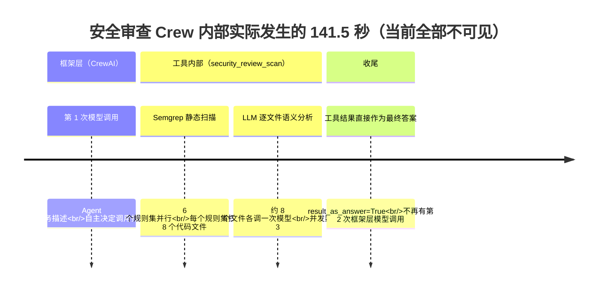

# 审查过程可观测性复盘与实施计划

**创建日期**：2026-08-25
**状态**：待评审（本文档为调研结论 + 实施计划，尚未动工）
**前置文档**：`plans/审查过程可观测性优化方案-2026-08-22.md`（v1 讨论稿，review_steps 表已按其落地）

---

## 一、复盘：为什么"看了这句话也不知道学到了什么"

### 1.1 现状取证（真实审查数据）

以审查 `0dee38f1-677f-43e1-8da8-453136539e02`（security 类型）为例，`review_steps` 表实际落库 **9 条步骤**：

| 序号 | 阶段 | 节点 | 内容摘要 | 耗时 |
|---|---|---|---|---|
| 1 | outer_flow | parse_project | 扫描到 49 个文件（代码 8），参与 Agent：security | 1390ms |
| 2~6 | outer_flow | skip_agent ×5 | 按审查类型跳过其余 5 个 Agent | - |
| **7** | **inner_crew** | **run_security_crew** | **"内层 Crew「资深代码安全审查专家」执行……产出 10 条发现"** | **141524ms** |
| 8 | outer_flow | aggregate | 去重前 10 → 去重后 10；严重度分布 critical 2 / warning 5 / suggestion 3 | 0ms |
| 9 | outer_flow | generate_report | 生成总结摘要 | - |

**核心矛盾：第 7 步一个 141.5 秒的步骤被压缩成了一句话。**

而这 141.5 秒内部实际发生的事（从代码还原的真实执行序列）：

用户的学习诉求 vs 当前记录能力的差距：

| 用户想知道的 | 当前能否回答 |
|---|---|
| 何时调用了模型？调了几次？每次多久？ | ❌ |
| 模型收到的完整提示词长什么样（角色如何注入）？ | ❌ |
| 何时调用了工具？传了什么参数？返回了什么？ | ❌ 只有结果条数 |
| Semgrep 各规则集的表现（扫描数/耗时/命中数）？ | ❌ |
| 逐文件 LLM 分析的过程与 token 消耗？ | ❌ |
| 这个顺序是谁定的——框架机制还是项目代码？ | ❌ |

### 1.2 根因分析（三个）

1. **内层 Crew 被当成黑盒**
   `backend/app/flows/review_flow.py` 的 `_run_crew_node()` 把整个 `crew.kickoff_async()` 包成一个整体步骤：开始记一次、结束记一次，中间过程不采集。

2. **工具内部动作没有埋点**
   扫描工具 `security_review_scan`（`backend/app/flows/crew_factory.py` 的 `_make_scan_tool`）内部调用各专业 Agent 的 `analyze()`：
   - Semgrep：6 个规则集经 `asyncio.gather` 并行执行（`security_agent.py`），无子步骤记录；
   - 逐文件 LLM 分析：走 `backend/app/agents/llm_client.py` 的 `run_llm_analysis() → llm_complete()`，**直接用 httpx 调 OpenAI 兼容接口，完全不经过 CrewAI**，框架事件总线天然看不到。

3. **CrewAI 自带的事件流没有被利用**（最关键）
   框架在执行过程中持续对外广播细粒度事件，项目没有接入这根线。详见 1.3。

### 1.3 关键发现：CrewAI 1.6.1 自带完整事件总线（已在容器中实测验证）

项目安装的是 **CrewAI 1.6.1**，其 `crewai.events` 模块提供事件总线（`crewai_event_bus`），支持 `@crewai_event_bus.on(事件类型)` 注册监听器。实测以下事件全部可用且字段丰富：

| 事件（广播） | 关键字段 | 能回答的问题 |
|---|---|---|
| 「LLM 调用开始」LLMCallStartedEvent | **messages（发给模型的完整提示词原文）**、model、tools、available_functions | 何时调模型、模型看到了什么 |
| 「LLM 调用完成」LLMCallCompletedEvent | response、call_type（tool_call / llm_call）、model | 模型答了什么、是不是工具决策 |
| 「LLM 调用失败」LLMCallFailedEvent | 错误信息 | 失败定位 |
| 「工具使用开始」ToolUsageStartedEvent | tool_name、**tool_args** | 何时调工具、传了什么参数 |
| 「工具使用结束」ToolUsageFinishedEvent | output、started_at/finished_at、from_cache | 工具返回了什么、耗时多少 |
| 「工具出错」ToolUsageErrorEvent | 错误信息 | 工具异常 |
| 「Crew 启动/完成/失败」CrewKickoff*Event | crew_name、inputs | 内层执行边界 |
| 「任务开始/完成/失败」Task*Event | task_id、task_name、agent_role | 任务级边界 |
| 「Flow 方法执行开始/结束」MethodExecution*Event | flow_name、method_name、state、params | 外层编排每一步的进入/退出 |
| 「Agent 推理开始/完成」AgentReasoning*Event | agent_role | 高级推理行为（本项目暂未开启，预留） |

**结论：用户要的"何时调模型、何时调工具"，框架已经替我们记录了，只差接入。**

---

## 二、改进方向总览

| 方向 | 解决什么 | 一句话概括 |
|---|---|---|
| **A. 接入 CrewAI 事件总线** | "何时调用了模型/工具、顺序为什么是这样" | 把框架广播的事件翻译成中文步骤落库+推送 |
| **B. 工具内部埋点** | "Semgrep 规则集粒度、逐文件 LLM 分析过程" | 给不走框架的原生 HTTP 调用补记录 |
| **C. 知识注释层** | "为什么会这样？是框架定的还是我们写的？" | 每步配"💡 为什么"知识卡片 + 源码链接 |

三者关系：**A+B 负责"看到全过程"（数据层），C 负责"看懂全过程"（学习层）。**

---

## 三、详细设计

### 3.1 方向 A：CrewAI 事件桥接器（P0）

**新增文件**：`backend/app/services/crew_event_bridge.py`

职责：向 `crewai_event_bus` 注册一次性全局监听器，把框架事件转换为 `review_steps` 记录 + `progress_emitter` 实时推送。

**事件 → 步骤映射表**：

| 框架事件 | 落库 phase / node_type | action_text 示例（中文） | detail 内容 |
|---|---|---|---|
| LLMCallStarted | llm / llm_call | "🧠 模型调用 #N：决定下一步动作（模型 deepseek-chat）" | messages 截断摘要、tools 列表 |
| LLMCallCompleted(call_type=tool_call) | llm / llm_call | "🧠 模型决定调用工具 security_review_scan" | response 摘要、耗时 |
| LLMCallCompleted(call_type=llm_call) | llm / llm_call | "🧠 模型输出最终整理结果" | response 摘要、耗时 |
| LLMCallFailed | llm / llm_call(failed) | "⚠️ 模型调用失败：…" | error |
| ToolUsageStarted | tool / tool_call | "🔧 调用工具 security_review_scan（参数：…）" | tool_args |
| ToolUsageFinished | tool / tool_call | "🔧 工具返回 N 条发现（耗时 Xs）" | output 摘要、from_cache |
| ToolUsageError | tool / tool_call(failed) | "⚠️ 工具执行失败：…" | error |
| CrewKickoffStarted/Finished | inner_crew 边界辅助 | 用于校准内层起止时间 | inputs |

**并行归属问题（关键技术点）**：

6 个 Crew 并行执行时，事件到达时必须知道属于哪次审查的哪个 Agent。方案：

1. 构建内层 Crew 时设置唯一名称：`Crew(name=f"{review_id}:{agent_name}")`（改 `build_review_crew` 增加参数）；
2. 桥接器维护内存映射表 `{agent_role / agent_id → (review_id, agent_name)}`；
   - `CrewKickoffStartedEvent` 带 crew_name 与 inputs → 建立 crew 维度映射；
   - LLM/Tool 事件带 `agent_role`、`agent_id`、`from_agent` → 反查归属；
3. 兜底：查不到归属的事件丢弃并打 structlog 警告（宁缺勿错）。

> 注：单进程部署下内存映射可靠；若未来多 worker 部署需换 Redis 等共享存储（当前项目规模不需要，记录为已知限制）。

**注册时机**：FastAPI 启动时（`main.py` lifespan）注册一次全局监听器；监听器内部做 try/except，任何异常只打日志、绝不影响审查主流程。

**改造点清单**：

| 文件 | 改动 |
|---|---|
| `backend/app/services/crew_event_bridge.py` | 新增（约 200 行） |
| `backend/app/main.py` | lifespan 中调用 `register_crew_event_bridge()` |
| `backend/app/flows/crew_factory.py` | `build_review_crew` 增加 `crew_name` 参数 |
| `backend/app/flows/review_flow.py` | `_run_crew_node` 传入 `crew_name=f"{review_id}:{agent_name}"` |

**预期效果**：每个内层 Crew 从 1 条粗步骤 → 约 3~12 条细步骤（1 次 LLM 决策 + 1 次工具调用 + 若干失败分支）。

### 3.2 方向 B：工具内部埋点（P0）

**B-1：Semgrep 规则集子步骤**

改 `backend/app/agents/security_agent.py` 的 `analyze()`：每个规则集扫描完成后记录一条步骤。

| 字段 | 值 |
|---|---|
| phase / node_type | tool / semgrep_ruleset |
| action_text | "Semgrep 规则集 python/django：扫描 8 个文件，命中 2 条（4.1s）" |
| detail | ruleset 路径、文件数、发现数、异常信息 |

其他 Agent（code_style 用 Ruff、dependency 用 pip-audit 等）同理，各自在确定性扫描环节加同构埋点。

**B-2：逐文件 LLM 分析埋点（contextvars 方案）**

逐文件分析走 `llm_client.py` 的原生 httpx，不经框架，必须手动埋。为避免改动所有调用方签名，用 Python 标准库 `contextvars`：

- 新增模块级上下文变量 `current_review_context: ContextVar[dict | None]`（含 review_id、agent_name）；
- `_run_crew_node` 在调用工具前 set，结束后 reset（工具在同协程链上执行，上下文自动传播）；
- `llm_complete()` 内读取该变量：有值则每次调用记一条步骤——

| 字段 | 值 |
|---|---|
| phase / node_type | llm / llm_file_analysis |
| action_text | "🧠 LLM 分析 file_1.py：发现 1 个问题（1860 tokens，2.8s）" |
| detail | 文件名、prompt_tokens、completion_tokens、耗时、findings 数 |

**B-3：打通 llm_usage 关联（顺带收益）**

`llm_complete()` 已把 token 用量写入 `llm_usage` 表但没关联审查。给 `LLMUsage` 加两个可空列 `review_id` / `agent_name`（或先塞进现有 JSON 字段，视表结构定），从 contextvars 取值填充。之后"本次审查花了多少 token"可直接聚合查询。

**改造点清单**：

| 文件 | 改动 |
|---|---|
| `backend/app/agents/security_agent.py`（及其余 5 个 Agent 同构） | 规则集级埋点 |
| `backend/app/agents/llm_client.py` | contextvars 定义 + `llm_complete` 埋点 + usage 关联 |
| `backend/app/flows/review_flow.py` | `_run_crew_node` 设置/清理 contextvars |

### 3.3 方向 C：知识注释层（P2，学习价值最大）

**C-1：知识卡片**

新建 `backend/app/services/step_knowledge.py`：按 node_type 配置固定文案（纯静态字典，无逻辑）。

| node_type | 卡片文案示例 |
|---|---|
| parse_project | "外层 Flow 是确定性编排：`@start` 标记起点，`@listen(parse_project)` 表示'解析完成后执行'。6 个 Crew 并行来自 Flow 的多 @listen 机制，不是手写线程池。" |
| llm_call（首次） | "这是 ReAct 模式的'思考'环节：CrewAI 把 role/goal/backstory + 任务描述拼成提示词发给模型，由模型自主决定先调哪个工具。这个决策是模型做的，不是代码写死的。" |
| tool_call | "工具由项目代码封装（`_make_scan_tool`）：闭包绑定项目路径，Agent 无需传参即可调用，保证调用可靠性。" |
| semgrep_ruleset | "Semgrep 是基于规则的静态扫描：快、确定、离线，但只能匹配已知模式；复杂语义漏洞交给后续 LLM 补充——两者互补。" |
| llm_file_analysis | "逐文件语义分析弥补规则引擎漏报：每个文件独立调用（并发 3），prompt 中注入了代码库上下文（context_enhancer）。" |
| run_*_crew 收尾 | "工具设置了 result_as_answer=True：扫描结果是确定性数据，无需再让模型复述格式化——省一次调用、大幅提速。典型的性能取舍。" |
| aggregate | "去重键 = (rule_id, file_path, line_start)，纯项目代码逻辑，与框架无关。" |
| skip_agent | "review_type 过滤是外层 Flow 的路由决策：类型不匹配的 Agent 直接跳过，省掉无效的模型调用。" |

落库方式：写入 `review_steps.detail` 的 `knowledge` 键（表结构不变）；存量旧步骤前端兜底显示通用说明。

**C-2：源码链接**

同一字典里配 `source_refs`：`[{file: "app/flows/review_flow.py", line: 120, desc: "_run_crew_node"}]`。
前端渲染为链接，指向仓库源码（本地开发环境可直接打开 VSCode 的 file:// 协议或复制路径）。

**C-3：前端展示增强（P1，与 C 配套）**

改 `frontend/src/pages/Review/ReviewDetail.tsx`：

1. 时间线支持两级嵌套：inner_crew 主步骤下缩进展示 tool / llm 子步骤（按 sequence + 时间范围归组）；
2. 渲染 `detail` 字段（当前后端存了但前端完全没渲染——现成浪费）：tokens、工具参数、规则集统计等以小标签/键值对展示；
3. 每步加"💡 为什么"折叠面板（knowledge）+ 源码链接（source_refs）；
4. 步骤头部加耗时占比条（相对总时长），一眼看出时间花在哪。

---

## 四、实施计划

### P0：数据完整性（方向 A + B，预计一次迭代）

| # | 任务 | 涉及文件 | 验收标准 |
|---|---|---|---|
| 1 | 新建事件桥接器模块 | services/crew_event_bridge.py | 单测：模拟事件→断言生成正确步骤 |
| 2 | main.py 注册桥接器 | main.py | 应用启动即生效，异常不影响主流程 |
| 3 | Crew 唯一命名 + 归属映射 | crew_factory.py / review_flow.py | 并行 6 Crew 时事件归属零串扰 |
| 4 | Semgrep 规则集埋点 | security_agent.py 等 6 个 Agent | 每次 ruleset 扫描产生一条子步骤 |
| 5 | llm_client contextvars 埋点 | llm_client.py / review_flow.py | 每次逐文件分析产生一条子步骤含 tokens |
| 6 | llm_usage 关联 review_id | llm_client.py（+模型列） | 可按审查聚合 token 消耗 |
| 7 | 真实审查端到端验证 | - | security 审查步骤数从 9 条 → 20+ 条，覆盖全部模型/工具调用 |

### P1：前端可视化（预计一次迭代）

| # | 任务 | 涉及文件 | 验收标准 |
|---|---|---|---|
| 8 | 两级嵌套时间线 | ReviewDetail.tsx | 子步骤缩进归组到所属 Agent 卡片下 |
| 9 | detail 字段渲染 | ReviewDetail.tsx | tokens/参数/统计可见 |
| 10 | 耗时占比条 | ReviewDetail.tsx | 时间分布一目了然 |

### P2：学习增强（方向 C）

| # | 任务 | 涉及文件 | 验收标准 |
|---|---|---|---|
| 11 | 知识卡片字典 | services/step_knowledge.py | 全部 node_type 有文案 |
| 12 | 源码链接 | step_knowledge.py + 前端 | 点击可跳转对应源码位置 |
| 13 | "💡 为什么"折叠面板 | ReviewDetail.tsx | 默认折叠，展开显示卡片 |

### 可选增强（暂不做，记录备忘）

- **Langfuse 接入**：项目介绍提过但从未实现。自建桥接器够用时不必引入；若未来需要 trace 级检索/回放再评估（CrewAI 底层 LiteLLM 支持 `LITELLM_SUCCESS_CALLBACKS="langfuse"`，接入成本低）。
- **流程图回放动画**：复用 ReviewProgress 的双层图，按步骤时间轴回放。
- **原始 prompt/response 全文查看**：量大，建议只在 detail 存截断摘要 + 提供"复制全文"按钮（可选）。

### 风险与对策

| 风险 | 对策 |
|---|---|
| 事件监听器抛异常影响审查主流程 | 监听器全量 try/except + structlog 告警，永不向上抛 |
| messages 全文过大撑爆 detail 字段 | 截断存储（如首尾各 500 字符），全文按需另存 |
| 并行写入 SQLite 写锁冲突 | 复用现有 recorder 的短重试机制；必要时合并批量写 |
| 多 worker 部署下内存映射失效 | 当前单进程不受影响；记录为已知限制 |
| 步骤数量膨胀（full 审查 6 Agent） | 前端默认折叠子步骤；提供"精简/详细"视图切换（沿用 v1 方案待确认项） |

---

## 五、验收演示脚本（P0 完成后）

1. 发起一次 `security` 类型审查（项目选 test-projects/python-simpleaichat）；
2. 打开详情页「执行流程」，应看到：
   - 解析项目 → （跳过 ×5）→ 安全 Crew 展开：
     - 🧠 模型调用 #1（含提示词摘要、耗时）
     - 🔧 工具调用 security_review_scan
       - Semgrep ×6 规则集子步骤（各含文件数/耗时/命中数）
       - 🧠 逐文件分析 ×N（各含 tokens/耗时/发现数）
     - 工具返回 10 条发现
   - 聚合 → 摘要；
3. 每步可展开 detail；点击"💡 为什么"出现知识卡片（P2 后）；
4. 设置页可看到本次审查关联的 token 总消耗。

---

## 六、待确认问题

1. **子步骤嵌套的表结构**：加 `parent_step_id` 列（需 ALTER TABLE 迁移）vs 纯靠 sequence+时间范围归组（零迁移但归组逻辑在前端）？倾向后者（SQLite 手工迁移成本 > 前端归组成本）。
2. **LLM 提示词原文**是否需要完整留存供学习？（建议：detail 存截断摘要 + 可选开关存全文到独立表）
3. **full 审查（6 Agent 并行）**下步骤可能达 60+ 条，是否需要"学习模式/精简模式"切换？

---

**最后更新**：2026-08-25
